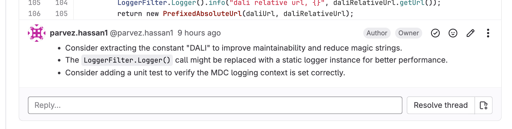

# AI Code Review for GitLab

**Inline AI code review on every GitLab merge request, using your own model and your own keys.**

[](https://www.npmjs.com/package/@parvez3019/ai-code-review-gitlab-plugin)
[](https://www.npmjs.com/package/@parvez3019/ai-code-review-gitlab-plugin)
[](https://github.com/parvez3019/ai-code-review-gitlab-plugin/actions/workflows/ci.yml)
[](https://github.com/parvez3019/ai-code-review-gitlab-plugin)
[](LICENSE)

📖 **Docs:** https://parvez3019.github.io/ai-code-review-gitlab-plugin/

A small, auditable CLI that reads a merge request diff, asks an LLM to review each hunk, and posts the feedback as **inline discussion threads** on the exact lines that changed. It runs in your GitLab runners and talks only to the provider you choose.



## Features

- 💬 **Inline comments on the exact line**, with severity and one-click GitLab suggestions, plus one summary note that is updated in place
- 🔁 **No duplicate comments on new pushes**: each commit is reviewed once, and only files changed since the last review are reviewed again
- 🎯 **Low noise**: skips lockfiles and generated code, filters by severity, and sends the full file and MR description as context
- 🔑 **Bring your own model**: Claude on **AWS Bedrock** or the **Anthropic API**, **Google Gemini**, or any **OpenAI-compatible** endpoint (OpenAI, **Ollama**, vLLM, LiteLLM, OpenRouter…)
- 🔒 **Your code stays in your cloud**: no SaaS in the middle; fully air-gapped with Ollama
- ⚡ **Zero-flag GitLab CI setup**: reads `CI_MERGE_REQUEST_IID`, `CI_MERGE_REQUEST_PROJECT_ID`, `CI_API_V4_URL` automatically
- 🧩 Ships as an **npm package**, a **Docker image** and a **one-line reusable CI template**
- 📝 **Custom prompts** from a repo file or S3, plus an optional `.ai-review.yml` per repository
- 🚦 `--fail-on` to block merges on serious findings, `--dry-run` to try prompts locally, and bounded retries on rate limits
- Works with gitlab.com and self-managed GitLab

## Quick start (60 seconds)

1. Add a project access token with the `api` scope as a masked CI/CD variable called **`CODE_REVIEW_GITLAB_TOKEN`**.
2. Add your provider key as a masked CI/CD variable, for example **`GEMINI_API_KEY`**, **`ANTHROPIC_API_KEY`**, or `AWS_ACCESS_KEY_ID` + `AWS_SECRET_ACCESS_KEY` for Bedrock.
3. Add this job to `.gitlab-ci.yml`:

```yaml
ai-code-review:
  image: node:20
  variables:
    AI_PROVIDER: gemini        # or: anthropic | bedrock | openai
  script:
    - npx -y @parvez3019/ai-code-review-gitlab-plugin
  rules:
    - if: $CI_PIPELINE_SOURCE == "merge_request_event"
```

Or use the reusable template in a single include:

```yaml
include:
  - remote: https://raw.githubusercontent.com/parvez3019/ai-code-review-gitlab-plugin/0.1.0/templates/ai-code-review.yml
    inputs:
      provider: anthropic
```

Open a merge request, and the review comments show up on the diff.

## Providers

| Provider | `AI_PROVIDER` | Credentials | Default model |
|---|---|---|---|
| [AWS Bedrock (Claude)](https://parvez3019.github.io/ai-code-review-gitlab-plugin/providers/bedrock/) | `bedrock` | `AWS_ACCESS_KEY_ID`, `AWS_SECRET_ACCESS_KEY`, `AWS_REGION` | `us.anthropic.claude-sonnet-5` |
| [Anthropic API](https://parvez3019.github.io/ai-code-review-gitlab-plugin/providers/anthropic/) | `anthropic` | `ANTHROPIC_API_KEY` | `claude-sonnet-5-5` |
| [Google Gemini](https://parvez3019.github.io/ai-code-review-gitlab-plugin/providers/gemini/) | `gemini` | `GEMINI_API_KEY` | `gemini-3.5-flash` |
| [OpenAI-compatible / Ollama](https://parvez3019.github.io/ai-code-review-gitlab-plugin/providers/openai-compatible/) | `openai` | `OPENAI_API_KEY` (optional), `OPENAI_BASE_URL` | set `AI_MODEL` |

Override the model with `AI_MODEL` or `--custom-model`.

## Why this instead of GitLab Duo, CodeRabbit or PR-Agent?

- **Small and auditable**: under 2,000 lines of TypeScript that a security team can read in one sitting
- **CI-native**: one job, with no webhook server and no SaaS app to approve
- **AWS-friendly**: reviews go through Bedrock in your own account
- **Free (MIT)**: you only pay for the tokens you use

There's a fuller, honest [comparison in the docs](https://parvez3019.github.io/ai-code-review-gitlab-plugin/comparison/).

## Documentation

- [GitLab CI setup](https://parvez3019.github.io/ai-code-review-gitlab-plugin/getting-started/gitlab-ci/) · [One-line CI template](https://parvez3019.github.io/ai-code-review-gitlab-plugin/getting-started/ci-template/) · [Docker](https://parvez3019.github.io/ai-code-review-gitlab-plugin/getting-started/docker/) · [CLI](https://parvez3019.github.io/ai-code-review-gitlab-plugin/getting-started/cli/)
- [All options](https://parvez3019.github.io/ai-code-review-gitlab-plugin/configuration/options/) · [Repository config file](https://parvez3019.github.io/ai-code-review-gitlab-plugin/configuration/config-file/) · [Environment variables](https://parvez3019.github.io/ai-code-review-gitlab-plugin/configuration/env-vars/) · [Custom prompts](https://parvez3019.github.io/ai-code-review-gitlab-plugin/configuration/custom-prompts/)
- [Webhook trigger](https://parvez3019.github.io/ai-code-review-gitlab-plugin/guides/webhook-trigger/) · [Self-managed GitLab](https://parvez3019.github.io/ai-code-review-gitlab-plugin/guides/self-hosted-gitlab/) · [Troubleshooting](https://parvez3019.github.io/ai-code-review-gitlab-plugin/troubleshooting/)

## Contributing

Issues, ideas and PRs are welcome. See [CONTRIBUTING.md](CONTRIBUTING.md). If this saves you review time, a ⭐ helps others find it.

## Acknowledgements

Originally based on [hataiit9x/gemini-review-code](https://github.com/hataiit9x/gemini-review-code).

## License

[MIT](LICENSE)
