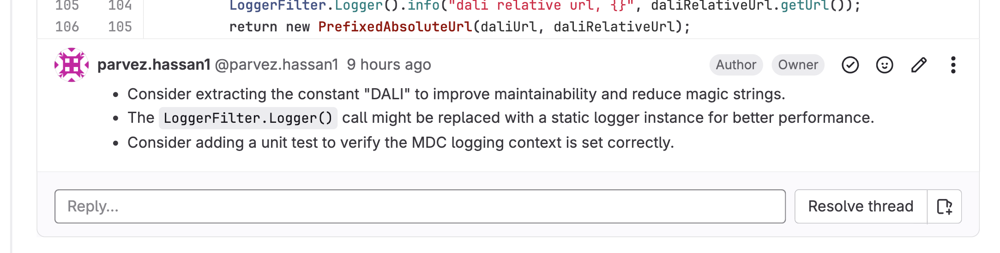

# AI Code Review for GitLab

**Inline AI code review on every GitLab merge request, using your own model and your own keys.**

`ai-code-review-gitlab-plugin` is a small open-source CLI that reads a merge request diff, asks an LLM to review each hunk, and posts the feedback as **inline discussion threads** on the exact lines that changed.



- :material-source-merge: **Inline comments**, on the changed line, not one giant wall of text
- :material-key: **Bring your own model**: Claude on [AWS Bedrock](providers/bedrock.md), the [Anthropic API](providers/anthropic.md), [Gemini](providers/gemini.md), or any [OpenAI-compatible / Ollama](providers/openai-compatible.md) endpoint
- :material-shield-lock: **Your code stays in your cloud**: runs inside your own GitLab runners and calls only the provider you configure
- :material-cog: **Zero-flag setup in GitLab CI**: picks up `CI_MERGE_REQUEST_IID`, `CI_MERGE_REQUEST_PROJECT_ID` and `CI_API_V4_URL` automatically
- :material-text-box-edit: **Custom prompts** from a local file or S3, so you can enforce your team's own review checklist
- :material-check-all: **Quiet when there's nothing to say**: hunks without significant feedback are rolled into a single summary note
- :material-license: **MIT licensed and free**: you only pay your LLM provider

## Quick start (60 seconds)

1. Create a project or group access token with the `api` scope and add it as a masked CI/CD variable called `CODE_REVIEW_GITLAB_TOKEN`.
2. Add your provider key as a masked CI/CD variable, for example `GEMINI_API_KEY` or `ANTHROPIC_API_KEY`.
3. Add this job to `.gitlab-ci.yml`:

```yaml
ai-code-review:
  image: node:20
  variables:
    AI_PROVIDER: gemini        # or: anthropic | bedrock | openai
  script:
    - npx -y @parvez3019/ai-code-review-gitlab-plugin
  rules:
    - if: $CI_PIPELINE_SOURCE == "merge_request_event"
```

Open a merge request. Review comments appear on the diff within a minute or two.

!!! tip "Prefer a one-line include?"
    Use the [reusable CI template](getting-started/ci-template.md) or the prebuilt [Docker image](getting-started/docker.md) to skip the `npm install` on every pipeline.

## How it works

```text
MR pipeline ──► fetch MR diffs (GitLab API)
             ──► split each file into hunks
             ──► send hunk + review prompt to your LLM
             ──► LLM answers with feedback, or "204" (nothing significant)
             ──► post feedback as an inline discussion on that line
             ──► post one summary note for the hunks with no feedback
```

## Next steps

- [Pick a provider](providers/bedrock.md) and its recommended model
- [Customise the review prompt](configuration/custom-prompts.md) for your team's standards
- [See how it compares](comparison.md) to GitLab Duo, CodeRabbit and PR-Agent
